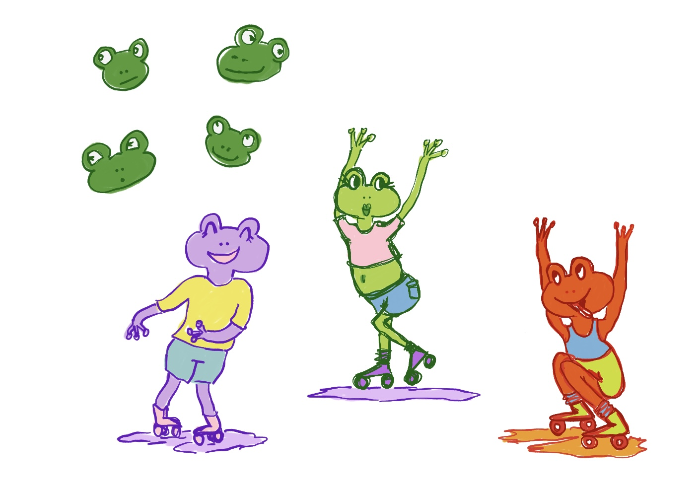

[work](/tech-writing/) | [services](/services/) | [speaking](/speaking/) | [pop culture](/pop-culture/) | [creative](/creative/) | [zines/books](/books/) | [illustration & prints](/illustration/) | [code](/code/) | [about](/about/)

Writer. Engineer. Bridge builder.

<strong>In short</strong>Coco Poley is a writer and former QA automation engineer based in Madrid, Spain. After seven years in software testing and data engineering (2016–2023), Coco moved into technical documentation and content marketing, and also writes pop culture features and poetry.

  
<b>7 yrs</b>software testing &amp; data engineering

  
<b>3 yrs</b>technical documentation &amp; content

  
<b>3 yrs</b>leading WEX's Pride ERG

  
<b>2</b>wonderful dogs

I'm a writer and former QA automation engineer who builds bridges between humans and systems. I spent seven years in software testing and data engineering, all the while writing for outlets like The Mary Sue and the Stack Overflow Blog, because I have always enjoyed a variety of content writing. For the last three years, I've written technical marketing content aimed at developer and stakeholder audiences.

These days I'm a content marketer with technical expertise, turning that same QA eagle-eyed precision into great writing.

## My background

I spent the first part of my career as a QA automation engineer, developing a deep understanding of software systems, testing frameworks, and developer workflows, then moved into data engineering. During that time, I always wrote for other outlets, like The Mary Sue and the Stack Overflow Blog.

Today I write across multiple formats and topics: technical documentation, blog content, features, interviews, and culture writing. I create clear, empathetic work that actually helps my audience, whether they're debugging an integration or deciding what to watch this weekend.

Published workMy writing has appeared in the Stack Overflow Blog, the TinyMCE Blog, and How-To Geek. I've created documentation and content for Fortune 500 companies including Apple, WEX, and Lumen Technologies, as well as developer tool platforms serving millions of users. <a href="/tech-writing/">See my portfolio →</a>

## Beyond work

  
<h3>Two wonderful dogs</h3>
They think they're people, and honestly, they might be right.

  
<h3>Reading fiction</h3>
Currently exploring LGBTQIA+ fantasy and sci-fi.

  
<h3>Advocating for inclusion</h3>
I served as Board Chair of WEX's Pride Employee Resource Group for three years and mentored students through Built by Girls' STEM program. I believe in making tech more accessible and inclusive, a philosophy that shows up in my documentation too.
<a class="more" href="/speaking/">See my DEI work →</a>

  
<h3>Making art</h3>
I write poetry, make zines, and illustrate.
<a class="more" href="/creative/">See creative work →</a>

I currently live in Madrid, Spain (Central European Time).

## Find me online

<ul class="badges">
  <li><a href="https://www.linkedin.com/in/cocowrites/">LinkedIn</a></li>
  <li><a href="https://www.chillsubs.com/profile/coco_writes">Chill Subs (all published work)</a></li>
  <li><a href="https://dev.to/itscocopo">DEV Community</a></li>
  <li><a href="https://github.com/cocopo-codes/">GitHub</a></li>
  <li><a href="https://www.youtube.com/channel/UCqYMV3E2V9zUS1kpI8450Dw">YouTube</a></li>
  <li><a href="https://www.instagram.com/cp_round_the_world">Instagram</a></li>
  <li><a href="https://linktr.ee/itscocopo">Linktree</a></li>
</ul>

  <h2>Get creative updates from Coco</h2>
  
Poetry, short stories, and news, straight to your inbox.

  <a class="btn" href="https://buttondown.com/cocos-catchall">Subscribe to Coco's Catchall</a>
  
For work inquiries, email <a href="mailto:coco_writes@icloud.com">coco_writes@icloud.com</a>.

