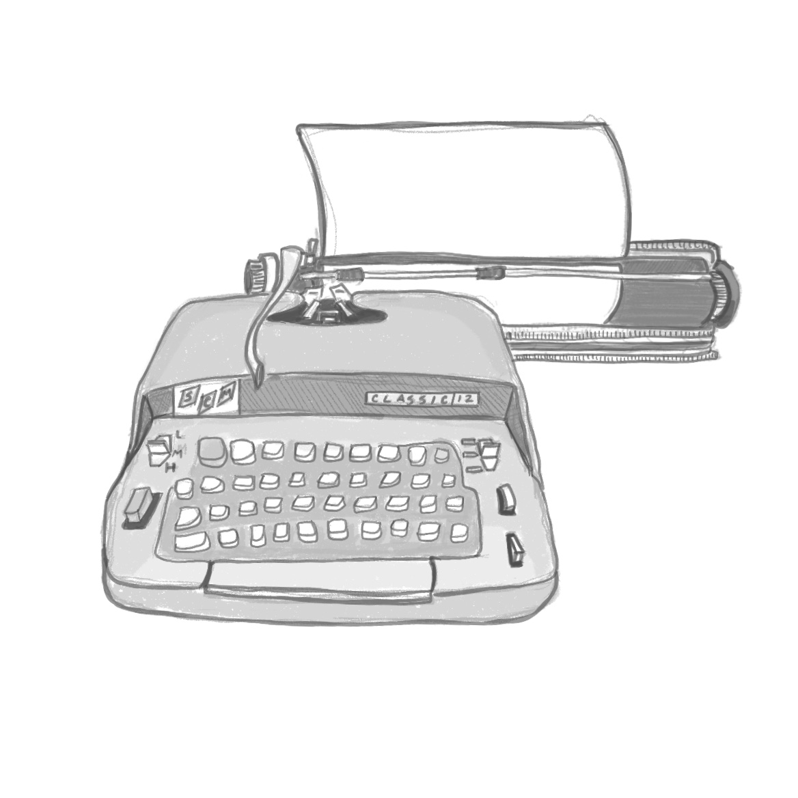
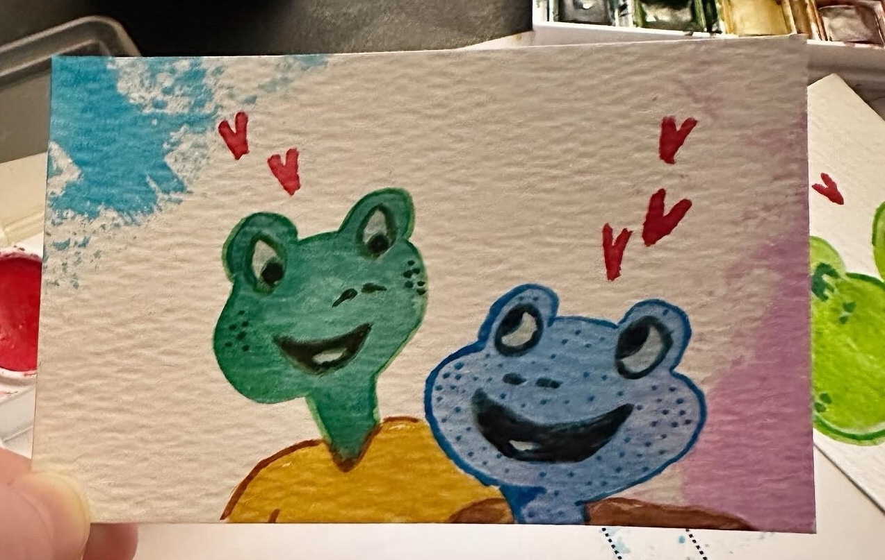
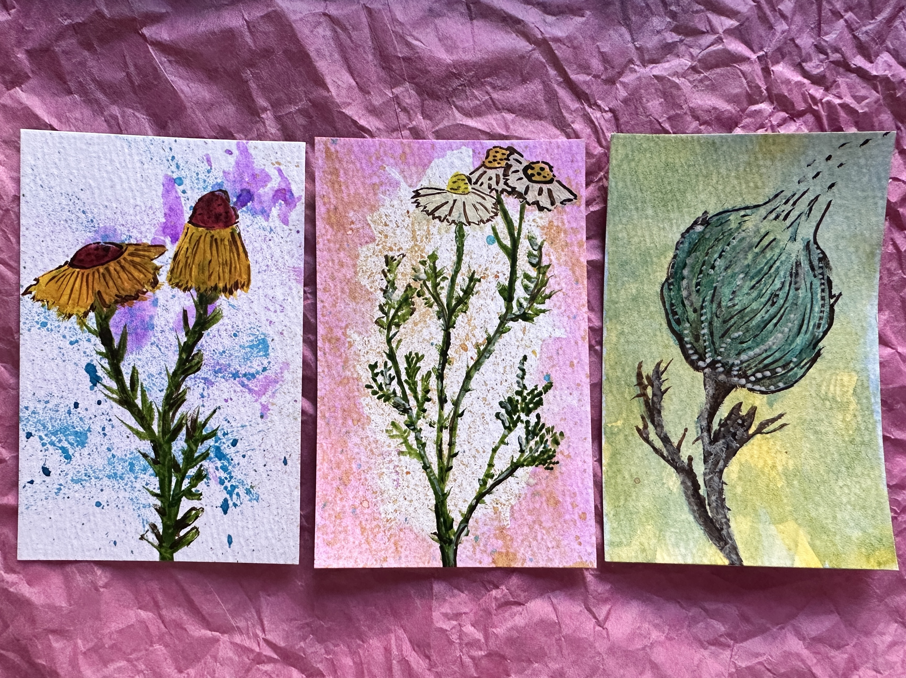
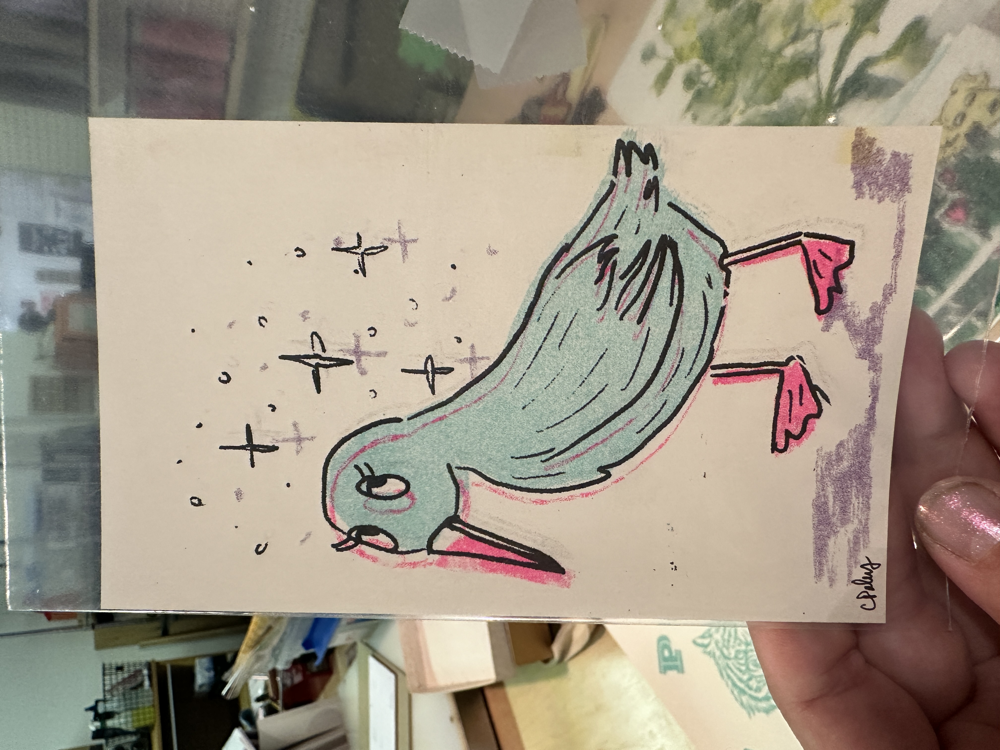
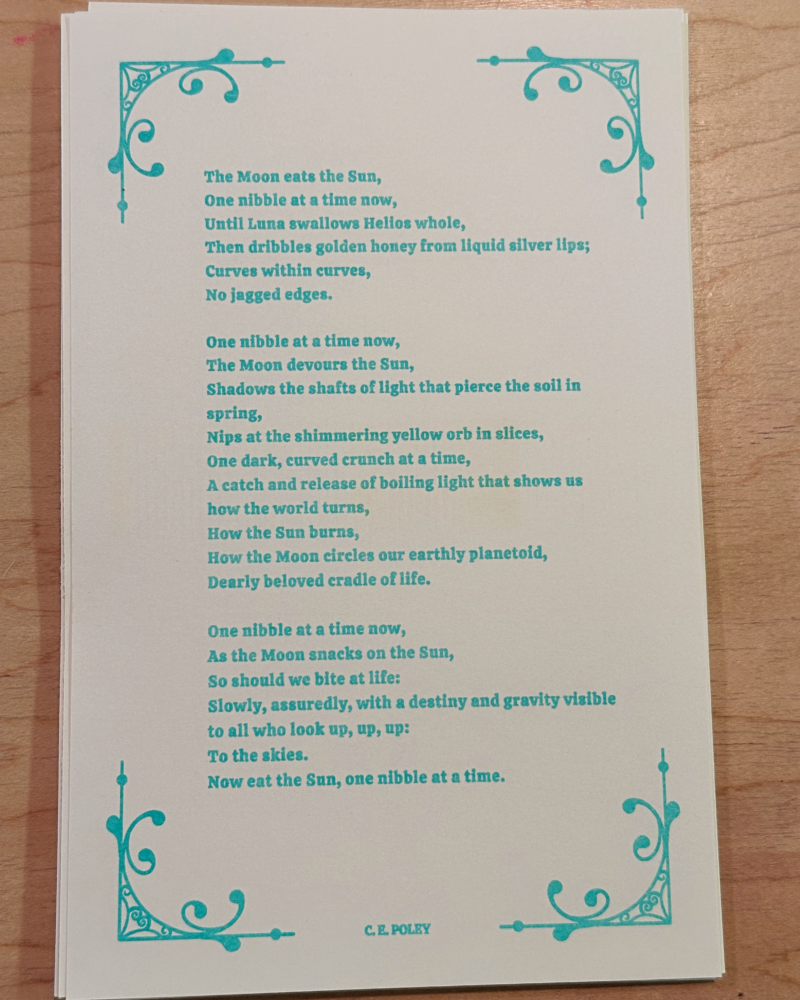
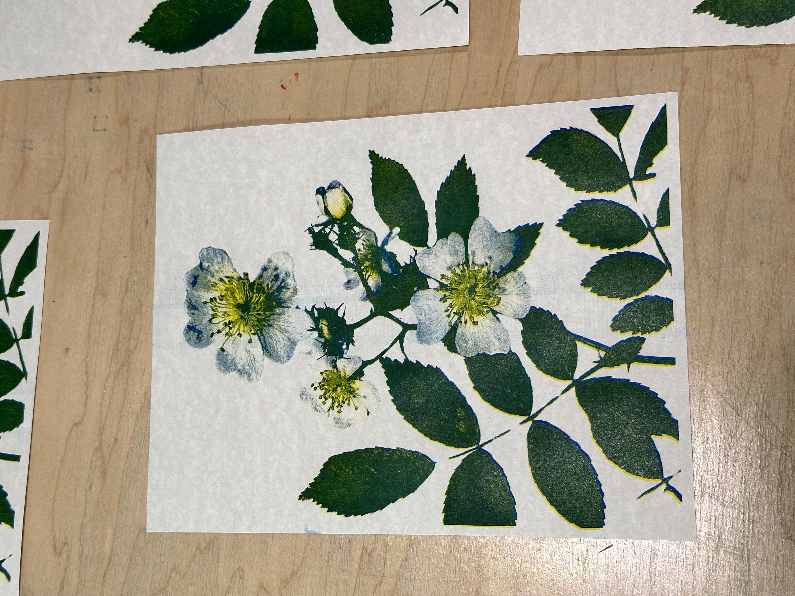

Coco is a self-taught illustrator who uses digital and analog mediums to create cute and fun artwork, meaningful prints, and sweet watercolor paintings. Please enjoy exploring Coco's illustrations, and see new work on Instagram at [@cavecanem_iv](https://www.instagram.com/cavecanem_iv/).

## Digital illustrations

A few of Coco's digital illustrations. 

## Watercolor paintings

A few of Coco's watercolors.

## Printed illustrations

A few of Coco's prints. 

##  Prints

A few more artistic prints. 

